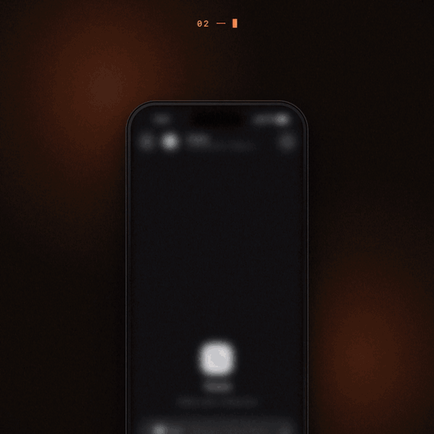
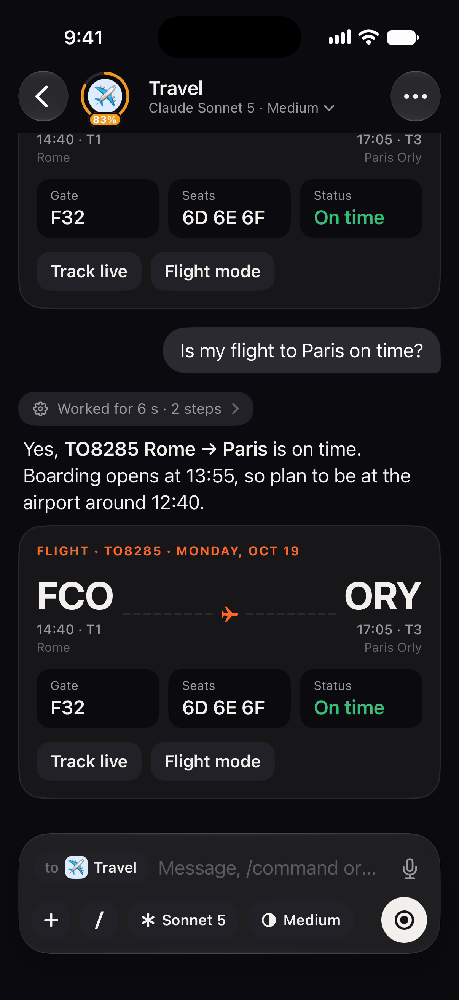
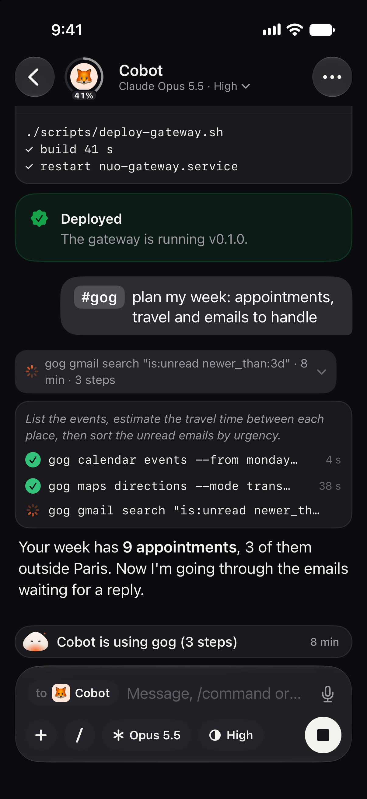
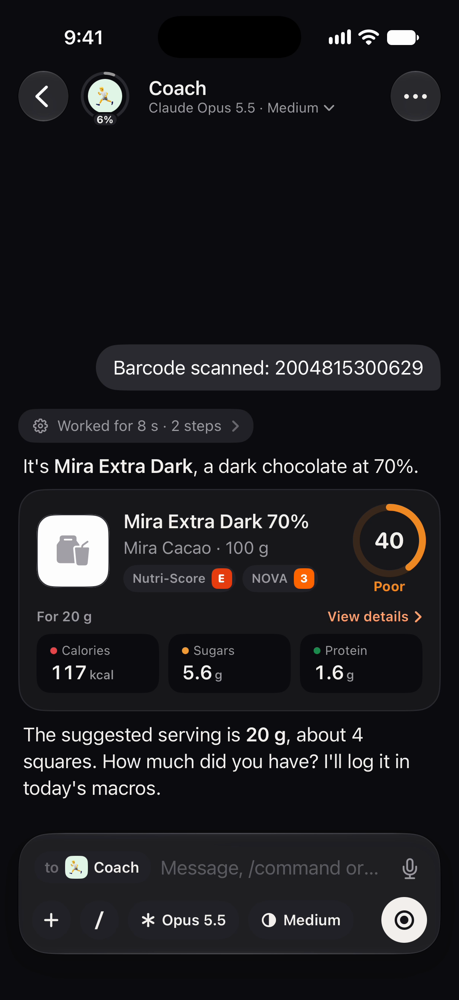
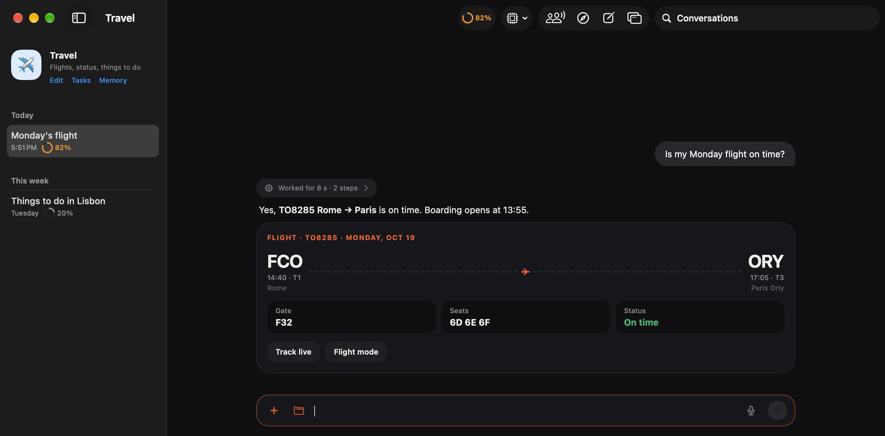
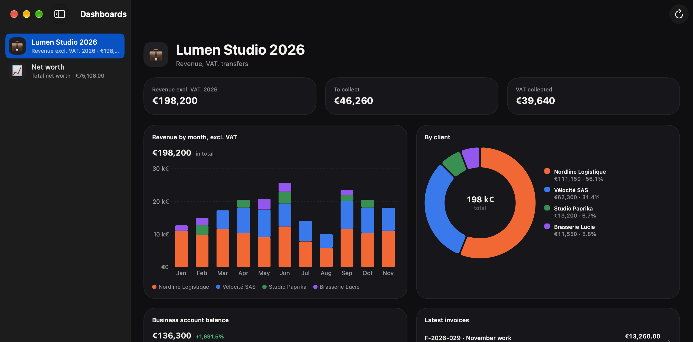
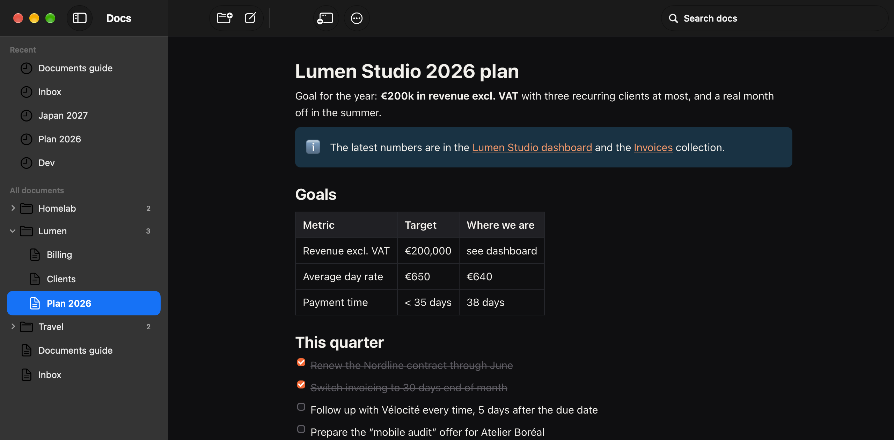

# Nuo

Your personal assistant, on your own server, in your pocket.

Nuo is a self-hosted personal assistant: a gateway that runs agents (Claude Code, Codex, Grok, Gemini) on a machine
you own, with native iPhone, Mac and Apple Watch apps to talk to them. Each agent becomes a bot with its own instructions, memory
and tools; around them, Nuo keeps your calendar, reminders, documents and data in one place that your bots can read
and update.

[](docs/media/nuo-demo.mp4)

Watch the [full demo (56 s)](docs/media/nuo-demo.mp4).

<p>
  
  
  
</p>
<p>
  
  
  
</p>

## Features

- **Bots on real agents.** Chat with Claude Code, Codex, Grok or Gemini running on your server, with streaming
  answers, tool calls you approve from the phone, slash commands, attachments and rich cards.
- **Native apps.** SwiftUI apps for iPhone, Mac and Apple Watch, with widgets, a share extension, dictation and
  meeting transcription, Face ID lock.
- **Calendar and booking.** One merged agenda of every calendar on your devices, event creation, travel time alerts,
  and public booking pages for others to pick a slot.
- **Reminders, projects and places.** Time and location reminders, areas and projects, pushed by the gateway.
- **Documents and data.** A git-backed Markdown workspace with a rich editor, typed collections in SQLite with full
  history, and dashboards built from SQL.
- **Scheduled tasks.** Prompts and commands that run on a schedule and report back.
- **Shared browser.** A persistent Chrome on the server that your agents drive and you watch live from the app.
- **Health and workouts.** Bots read Apple Health on the iPhone at the moment of the question and put structured
  sessions on the Apple Watch.
- **Profiles.** A few friends can share one gateway, each isolated in their own profile and Linux user.
- **Security first.** Device keys in the Secure Enclave, short bound tokens, TOTP enrolment, network zones,
  step-up with Face ID for dangerous actions ([security model](docs/security.md)).

## How it works

```
 iPhone / Mac / Watch apps ──HTTPS + WebSocket──▶ gateway (Bun, TypeScript) ──ACP──▶ agent CLIs
                                                    │                              (Claude Code, Codex, Grok, Gemini)
                                                    ├── SQLite: conversations, devices, data, calendar mirror
                                                    ├── git: Markdown documents
                                                    └── MCP server: lets bots use reminders, calendar, data, devices
```

The gateway is the only thing the apps talk to. It runs the agents through the
[Agent Client Protocol](https://agentclientprotocol.com), stores everything on your machine, and sends push
notifications through APNs. Reach it on your local network, through a VPN, or through a tunnel.

## Quick start

1. **Try the apps without a server**: build the iOS or Mac app in Xcode with the `-demo` launch argument.
2. **Run the gateway on your computer**: `make local-setup`, `make local-run`, `make local-pair`, then pair the
   app.
3. **Install it on a server**: `scripts/install.sh --host you@your-server --from-local`.

Step by step: [docs/getting-started.md](docs/getting-started.md).

## Documentation

| Topic | |
|---|---|
| [Getting started](docs/getting-started.md) | demo mode, local gateway, building with your Apple account |
| [Server install](docs/install.md) | install, network, upgrade, backup, move, uninstall |
| [Private overlay](docs/private-overlay.md) | keep your own bots, tools and collections out of the repository |
| [Security model](docs/security.md) | threat model and the layers that answer it |
| [Profiles](docs/profiles.md) | sharing a gateway with friends |
| [Distribution](docs/distribution.md) | Ad Hoc iPhone builds and notarized Mac builds |
| [Protocol](docs/protocol.md) | REST and WebSocket API between apps and gateway |
| [Files on the gateway](docs/layout.md) | what lives where under `~/nuo` |
| [Data](docs/data.md), [Documents](docs/documents.md), [Calendar](docs/calendar.md), [Health](docs/health.md) | feature references |

## Repository layout

| Folder | What |
|---|---|
| `gateway/` | Bun/TypeScript gateway: bots, agents, profiles, auth, schedules, data |
| `ios/` | SwiftUI apps (iPhone, Mac, Watch, widgets, share extension) and the document editor |
| `scripts/`, `deploy/` | install, deploy, backup and host setup |
| `docs/` | documentation |

## Contributing

Issues and pull requests are welcome: see [CONTRIBUTING.md](CONTRIBUTING.md). Report security issues privately as
described in [SECURITY.md](SECURITY.md).

## License

[MIT](LICENSE)
